# Physical VLA Lab

Latest training: [precision-oriented refinement](docs/project/BALL_PRECISION_TRAINING.md) completed with modest prediction improvement; no candidate passed the predeclared gates, so the parent checkpoint is retained. Sampling variability and systematic prediction error remain unresolved; the [matched fixed-input diagnostic](docs/project/BALL_SAMPLING_DIAGNOSTIC.md#observed-result--31-october) finds30-step sampling slower and less accurate than10 on the selected inputs. Retain10 steps; prediction bias and noise sensitivity both remain. The [full-episode shared-noise comparison](docs/project/BALL_NOISE_REPLANNING.md#observed-result--31-october) also shows no reliable improvement across eight seeds; it is not adopted. A [matched executed-prefix training ablation](docs/project/BALL_PREFIX_ABLATION.md) is prepared to compare temporal weighting against equal-budget uniform continuation (GPU results pending).

Latest development: the height intervention still failed, with early contact preceding the intervention. The [fixed-command smoothing comparison](docs/project/BALL_SMOOTHING_DIAGNOSTIC.md) also fails: premature finger contact advances from frame120 to97. This filter is not adopted; no successful learned ball grasp is established.

**Evidence-based research on dynamic manipulation and physical generalization in vision-language-action policies, built on RoboPhys.**

This project connects RoboPhys simulation, expert demonstrations, synchronized visual data, and pretrained VLA policies. The initial testbed is dynamic grasping with a simulated Franka arm. The research objective is to understand when learned behavior transfers across physical conditions and why it fails.

This is an independent research integration, not the upstream RoboPhys benchmark or an official DynamicVLA release.

**Latest result:** the [DynamicVLA ball policy](docs/project/BALL_LIVE_POLICY.md) completes 269 live control intervals and 807 physics steps with verified input/action binding and unchanged safety checks, but **does not grasp the ball**. Premature right-finger contact at frame 104 precedes gripper chatter; the successful expert first contacts at 162. Matched-input inference now confirms image and state sensitivity; an eight-frame formal-render control shows no clear improvement. Bounded lower-learning-rate refinement now reduces recorded-input approach target error from 66.70 to 61.26 mm, but position p95 worsens. Its full live rollout still fails with no finger contact despite near-center alignment; an explicit [height-only diagnostic](docs/project/BALL_VERTICAL_DIAGNOSTIC.md) is prepared. This remains one exposed training case, not physical generalization evidence.

## Current status — 31 October 2026

The guarded worker-history launch now reproduces all three selected original episodes: failed58, failed59 and successful60, with all15 full-length action/observation arrays per episode matching exactly. The target retains at least60.349mm lift. A [single matched-startup fresh60 control](docs/project/WORKER_HISTORY_DIAGNOSTIC.md#observed-reproduction-and-one-matched-startup-control-30-october) is prepared to distinguish process history from changed startup scheduling (263 CPU checks). This is expert reproducibility evidence; learned ball-policy success remains unestablished.

The [Linux watch-resource shortage](docs/project/NATIVE_STARTUP_RESOURCES.md) has recovered after VS Code reload: 512/512 allocation and CPU scene-loading checks pass with zero watch errors. The matched fresh60 run now starts normally but reproduces the earlier safety-aborted failure exactly in 15 arrays, while history58/59/60 reproduces original success. This isolates a worker-history/reset contrast beyond the loading barrier; the specific mechanism remains unknown. [Matched-control evidence](docs/project/WORKER_HISTORY_DIAGNOSTIC.md#matched-fresh60-result-history-contrast-persists).

The [single wind-force intervention](docs/project/SETUP_FORCE_CONTROL.md#observed-result-startup-ball-mismatch-removed-finger-response-differs) now restores exact ball velocity/pose through native rows0..500, but grasp still fails. Recorded close targets match; actual fingers close more slowly and first contact is about89ms later. Next inspect actual gripper drive/reset state. This is modified-force expert evidence, with no learned-policy success or general reset fix.

The [passive gripper-drive pair](docs/project/GRIPPER_DRIVE_DIAGNOSTIC.md#observed-result-30-october) now verifies a concrete initialization mismatch: first-episode setup reports requested10500/140 gains but native readback remains10000/1000 on the first finger and0/0 on the mimic finger; later history episodes retain10500/140 on both. At closure both conditions have the same70N force ceiling and0.05m/s speed ceiling. Known motion arrays remain exact under observation. The [single post-setup gain reapplication](results/summaries/2026-10-30-gripper-gain-reapplication-result.json) now succeeds:319 intervals/957 physics callbacks, independent grasp pass, all15 core arrays and all958 native ball pose/velocity rows exactly match original success. Continuous bilateral contact lasts2.483s with at least60.349mm final lift. This restores one exposed fresh-worker expert case under the explicit force/gain controls; learned-policy success and production mimic consistency remain unverified. The initialized surrogate outcome is reported below.

The initialized29D surrogate now verifies startup force/gain alignment but stops after179 complete intervals (180 recorded frames) of319. All180 issued command-boundary fields and jaw targets match the decoded action prefix; full-stream interface flags remain false because the run aborts. First contact166 and bilateral contact170 match the successful teacher. EE error exceeds0.01mm at172 and grows from0.0031mm at171 to4.3217mm at179. Native safety rejects the next command after joint5 reaches-2.8248rad/s against the2.61rad/s limit; required braking also conflicts with acceleration/jerk bounds. Independent grasp fails without sustained lift. This is an expert-labelled interface diagnostic, not learned-policy inference. [Verified result](results/summaries/2026-10-31-initialized-contract-result.json).

The [matched float64-label control](docs/project/INITIALIZED_ACTION_CONTRACT.md#matched-precision-result--31-october) now passes: 319 intervals/957 callbacks, 2.483 s bilateral contact, at least 57.768 mm lift and no assistance. All 15 core arrays through the previous float32 failure window match the successful teacher exactly. This supports contact-stage sensitivity to numeric quantization in one exposed case. Stable float32 control and tolerance to prediction errors remain required before learned-policy training; no VLA success is claimed.

| Workstream | Verified progress | Remaining work |
|---|---|---|
| Franka action interface | Recorded-tool FK verified across all 40 ball episodes; explicit Cartesian request execution grasps successfully on one exposed seed without online task/skill decisions | Live policy action contract and learned dynamic grasping |
| DynamicVLA baseline | Pretrained-model loading, fine-tuning and offline evaluation on an earlier egg-object task | Offline prediction improvements have not established robust closed-loop success |
| Wind-driven ball demonstrations | 40 collector-accepted physical grasps; recording/contact checks and descriptive quality screen completed | Full visual review and downstream training conversion |
| Visual data pipeline | All 40 revised-camera episodes verified at 60 Hz (12,154 frames); all 19 remote episodes delivered through the private Hub to the main machine | Trajectory quality/visibility review and downstream action conversion |
| Physical generalization | Evaluation questions and failure-analysis workflow defined | Independent held-out physical conditions and systematic experiments |
| UR10e | Later-stage research direction | Embodiment adaptation, simulation validation and supervised hardware experiments |

The 40 ball episodes are **expert development data, not 40 VLA successes**. No disturbance-robustness improvement or sim-to-real transfer is claimed. The [effort-control probes](docs/project/HGWIND_EFFORT_PROBE.md) exposed an action-reference mismatch: recorded-motion joint tracking runs safely but loses the ball during lift. A constructed task-space reference performed worse; endpoint semantics were audited and the native pose-servo adapter aborted after contact. The original expert and complete-control physical replay both reproduce one source episode exactly across all 15 core numeric arrays. The native geometry implementation now recomputes all 194 task Jacobians from live robot state and exactly reproduces the successful episode. Other logged command references remain. Zeroing task-acceleration feedforward completed safely but missed the object; retain the passing reference while defining the complete Cartesian feedback contract. The [original Cartesian target capture](docs/project/CARTESIAN_TARGET_CAPTURE.md) now verifies 194 upper calls with exact source-array reproduction. Upper-target feedback reexecution now passes physical grasp checks over 209 intervals: all 194 regenerated control references and all 15 core arrays exactly match the exposed source episode. This component explicitly retains native expert scheduling, source settings, live safety callbacks, gripper and terminal fallback. An [explicit packet interface](docs/project/CARTESIAN_PACKET_INTERFACE.md) now bypasses online expert decisions and owns jaws/terminal Cartesian hold; after correcting geometry-query, jaw-mode and measured-robot-motion context, its physical run passes all 209 intervals / 627 OSC updates and independent grasp checks. Continuous bilateral contact lasts 1.2 s with at least 74.861 mm retained lift. All first 194 core frames match the source exactly; the final 15 intervals use Cartesian hold. The recorded motion/settings schedule remains, so this is not a learned-policy result. 243 CPU checks pass. The fixed-9/8 gain diagnostic also passes all 209 intervals and independent grasp checks, retaining at least 72.577 mm lift without the later gain switch. The measured-posture ablation executes safely but loses final grasp retention. In this exposed case the passing posture anchor reconstructs exactly from initial robot joints plus sampled robot trajectory variation; preserve the passing fixed-gain baseline. Live-initialized latched posture now passes two same-seed repeats, with identical core arrays, 1.2 s bilateral contact and about 72.595 mm retained lift. This verifies one exposed case; it is not a cross-trajectory success-rate result. Other recorded settings/motion dependencies remain. A live policy action contract remains unverified. See [results and limitations](docs/project/RESULTS.md).

The first [integrated ball action-contract check](docs/project/BALL_ACTION_CONTRACT.md) now completes 209 intervals safely and verifies the 29D action boundary, live posture and always-on geometry callbacks. **Final grasp retention fails:** bilateral contact lasts 0.433 s rather than the passing reference's 1.2 s. Two strict-equality report issues were corrected for normalized-vector roundoff only; fixing the report does not change the physical outcome. Contact-stage divergence precedes the changed callback activation. Freeze the interface and use a bounded 3–5 distinct development-episode diagnostic before further controller changes or formal training. No new VLA result is claimed; existing 9D ball recordings lack complete new upper-command labels. See the [source-backed result](results/summaries/2026-10-29-ball-action-contract-result.json).

The [bounded paired diagnostic](docs/project/CONTRACT_VIDEO_BATCH.md) now completes after the recording fix: `traj_00018` reproduces its native teacher exactly and passes the frozen 29D surrogate with 1.767 s bilateral contact and 57.277 mm retained lift. The other two native teachers abort on motion feasibility before surrogate testing; their early divergence from source remains unresolved. All four new saved runs have five verified review videos each. This is one additional development-case success, not learned-policy performance, broad contract validation or training readiness. See [verified results](results/summaries/2026-10-29-bounded-contract-batch-result.json).

The startup-force diagnostic now records a complete measurement under GDB: 169 recorded frames, the same motion-safety abort as the prior fresh-worker teacher, and five verified review videos. All 15 compared action/observation/native arrays match that failure exactly. Ten fan force calls were observed, including four before control-frame recording at the same simulation clock; none had a zero configured physics dt. Original force-call history remains unavailable, so these calls do not establish causality. The later guarded [worker-history comparison](docs/project/WORKER_HISTORY_DIAGNOSTIC.md) reproduces all three original episodes exactly in15 full action/observation arrays per episode, including successful attempt60. It also changes startup scheduling, so a matched-startup fresh60 comparison is prepared before attributing causality. No native crash recurs in that launch, which does not establish a general startup fix. Rendering remains optional (`--render`); raw trajectories and analysis are retained by default. 263 CPU checks and actual scene/native-entry preflight pass; the matched fresh control is pending. See the [measurement](results/summaries/2026-10-29-startup-force-measurement.json).

## Workflow

```mermaid
flowchart LR
    A[RoboPhys scenes and task semantics] --> B[Simulator expert]
    B --> C[Raw actions, states, contacts and provenance]
    C --> D[Recording and physical-evidence checks]
    D --> E[Calibrated 60 Hz multi-view rendering]
    E --> F[Data alignment and explicit action conversion]
    F --> G[Pretrained DynamicVLA fine-tuning]
    G --> H[Closed-loop Franka evaluation]
    H --> I[Failure analysis and held-out physical evaluation]
```



Simulator state is available to experts and evaluators. A learned policy must use its documented camera, proprioception and language inputs; object ground truth must not become an undisclosed policy input.

## What this repository contains

- `src/capstone_vla/`: action interfaces, execution adapters, data checks, metrics and verified archive delivery. The historical Python package name is retained for compatibility.
- `scripts/`: research and diagnostic entry points, including collection and two-machine rendering orchestration.
- `tests/`: CPU regressions plus environment-dependent integration checks.
- `configs/examples/`: sanitized configuration templates; operational configurations stay local.
- `docs/project/`: architecture, reproduction boundaries, results and roadmap.
- `results/summaries/`: small, source-hashed result summaries rather than raw episodes or model weights.

## CPU-only checks

Use a separate Python 3.12 environment. This command does not launch simulation, download weights or contact a robot:

```bash
python3.12 -m venv .venv_cpu
.venv_cpu/bin/python -m pip install -r requirements-cpu.txt
PYTHONPATH=src .venv_cpu/bin/python -m pytest -q   tests/test_hgwind_cohort.py tests/test_hgwind_render_delivery.py   tests/test_hf_archive.py tests/test_prediction_metrics.py tests/test_chunk_execution.py tests/test_publication.py tests/test_trajectory_quality.py tests/test_recorded_franka.py tests/test_hgwind_effort_probe.py tests/test_grasp_evidence.py tests/test_live_kinematics.py tests/test_cartesian_target_trace.py tests/test_cartesian_target_replay.py tests/test_cartesian_packets.py
```

These tests use synthetic fixtures. They verify software contracts, not grasp success. Other tests may require local data, USD assets or Isaac installations.

## Simulation and training setup

The existing simulator uses **Isaac Sim 4.5 / Isaac Lab 2.2.1**. Model/data dependencies are isolated from it. Do not upgrade the simulator to match a baseline's upstream requirements.

Simulation entry points currently retain experiment-specific paths and require separately provisioned RoboPhys assets, saved manifests and local configuration. This repository is a research source release, **not a turnkey distribution of those assets**. Read [reproduction boundaries](docs/project/REPRODUCIBILITY.md) before running any simulation or remote orchestration script.

## Research direction

The planned contribution is an evidence-backed account of physical generalization: separate observation, action execution and contact failures; control changes in physical conditions; and evaluate recovery under explicit disturbances after establishing a reliable baseline. These are research goals, not established novelty claims. [Roadmap](docs/project/ROADMAP.md).

## Attribution and updates

RoboPhys supplies the benchmark scenes, expert and evidence framework. [DynamicVLA](https://github.com/hzxie/DynamicVLA) supplies the pretrained policy baseline and upstream learning tools. See [third-party notice](THIRD_PARTY.md) for revision and licensing boundaries.

Code changes, verified results, limitations and direction changes are maintained together through [the update policy](CONTRIBUTING.md) and [changelog](CHANGELOG.md). Large data and checkpoints are managed separately; this repository contains no access credentials.
