# Physical VLA Lab

**Evidence-based research on dynamic manipulation and physical generalization in vision-language-action policies, built on RoboPhys.**

This project connects RoboPhys simulation, expert demonstrations, synchronized visual data, and pretrained VLA policies. The initial testbed is dynamic grasping with a simulated Franka arm. The research objective is to understand when learned behavior transfers across physical conditions and why it fails.

This is an independent research integration, not the upstream RoboPhys benchmark or an official DynamicVLA release.

## Current status — 28 October 2026

| Workstream | Verified progress | Remaining work |
|---|---|---|
| Franka action interface | Cartesian/joint adapters, timing checks, recorded-tool FK verified across all 40 ball episodes; isolated effort-control probe prepared | Reliable end-to-end learned dynamic grasping |
| DynamicVLA baseline | Pretrained-model loading, fine-tuning and offline evaluation on an earlier egg-object task | Offline prediction improvements have not established robust closed-loop success |
| Wind-driven ball demonstrations | 40 collector-accepted physical grasps; recording/contact checks and descriptive quality screen completed | Full visual review and downstream training conversion |
| Visual data pipeline | All 40 revised-camera episodes verified at 60 Hz (12,154 frames); all 19 remote episodes delivered through the private Hub to the main machine | Trajectory quality/visibility review and downstream action conversion |
| Physical generalization | Evaluation questions and failure-analysis workflow defined | Independent held-out physical conditions and systematic experiments |
| UR10e | Later-stage research direction | Embodiment adaptation, simulation validation and supervised hardware experiments |

The 40 ball episodes are **expert development data, not 40 VLA successes**. No disturbance-robustness improvement or sim-to-real transfer is claimed. The [effort-control probes](docs/project/HGWIND_EFFORT_PROBE.md) exposed an action-reference mismatch: recorded-motion joint tracking runs safely but loses the ball during lift. A constructed task-space reference performed worse; endpoint semantics were audited and the native pose-servo adapter aborted after contact. An original-expert reference with trace-only instrumentation now awaits simulation. See [results and limitations](docs/project/RESULTS.md).

## Workflow

```mermaid
flowchart LR
    A[RoboPhys scenes and task semantics] --> B[Simulator expert]
    B --> C[Raw actions, states, contacts and provenance]
    C --> D[Recording and physical-evidence checks]
    D --> E[Calibrated 60 Hz multi-view rendering]
    E --> F[Data alignment and explicit action conversion]
    F --> G[Pretrained DynamicVLA fine-tuning]
    G --> H[Closed-loop Franka evaluation]
    H --> I[Failure analysis and held-out physical evaluation]
```



Simulator state is available to experts and evaluators. A learned policy must use its documented camera, proprioception and language inputs; object ground truth must not become an undisclosed policy input.

## What this repository contains

- `src/capstone_vla/`: action interfaces, execution adapters, data checks, metrics and verified archive delivery. The historical Python package name is retained for compatibility.
- `scripts/`: research and diagnostic entry points, including collection and two-machine rendering orchestration.
- `tests/`: CPU regressions plus environment-dependent integration checks.
- `configs/examples/`: sanitized configuration templates; operational configurations stay local.
- `docs/project/`: architecture, reproduction boundaries, results and roadmap.
- `results/summaries/`: small, source-hashed result summaries rather than raw episodes or model weights.

## CPU-only checks

Use a separate Python 3.12 environment. This command does not launch simulation, download weights or contact a robot:

```bash
python3.12 -m venv .venv_cpu
.venv_cpu/bin/python -m pip install -r requirements-cpu.txt
PYTHONPATH=src .venv_cpu/bin/python -m pytest -q   tests/test_hgwind_cohort.py tests/test_hgwind_render_delivery.py   tests/test_hf_archive.py tests/test_prediction_metrics.py tests/test_chunk_execution.py tests/test_publication.py tests/test_trajectory_quality.py tests/test_recorded_franka.py tests/test_hgwind_effort_probe.py tests/test_grasp_evidence.py
```

These tests use synthetic fixtures. They verify software contracts, not grasp success. Other tests may require local data, USD assets or Isaac installations.

## Simulation and training setup

The existing simulator uses **Isaac Sim 4.5 / Isaac Lab 2.2.1**. Model/data dependencies are isolated from it. Do not upgrade the simulator to match a baseline's upstream requirements.

Simulation entry points currently retain experiment-specific paths and require separately provisioned RoboPhys assets, saved manifests and local configuration. This repository is a research source release, **not a turnkey distribution of those assets**. Read [reproduction boundaries](docs/project/REPRODUCIBILITY.md) before running any simulation or remote orchestration script.

## Research direction

The planned contribution is an evidence-backed account of physical generalization: separate observation, action execution and contact failures; control changes in physical conditions; and evaluate recovery under explicit disturbances after establishing a reliable baseline. These are research goals, not established novelty claims. [Roadmap](docs/project/ROADMAP.md).

## Attribution and updates

RoboPhys supplies the benchmark scenes, expert and evidence framework. [DynamicVLA](https://github.com/hzxie/DynamicVLA) supplies the pretrained policy baseline and upstream learning tools. See [third-party notice](THIRD_PARTY.md) for revision and licensing boundaries.

Code changes, verified results, limitations and direction changes are maintained together through [the update policy](CONTRIBUTING.md) and [changelog](CHANGELOG.md). Large data and checkpoints are managed separately; this repository contains no access credentials.
